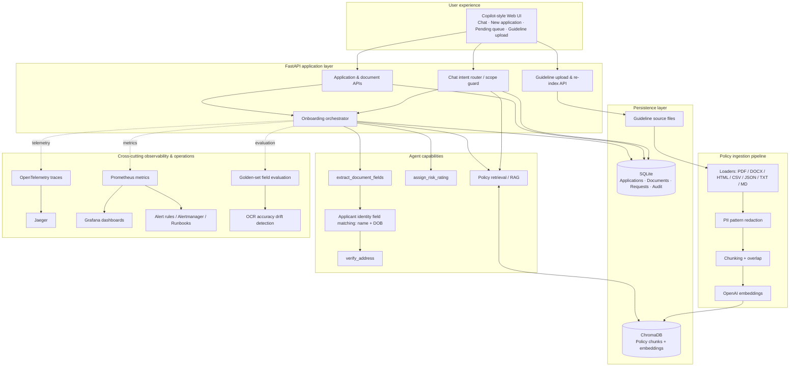

# Architecture — Onboarding Accelerator

## Main runtime paths
- **Scenario 1 — pending queue:** chat asks the SQLite application store for applications with no assessment or with a review/needs-information status, then returns application IDs.
- **Scenario 2 — modification:** the user identifies an existing application ID; name/address/DOB changes are persisted with audit events and automatically trigger re-verification against active documents. Replacement uploads supersede the previous active document of that type, invalidate the prior assessment and are reprocessed by the UI.
- **Scenario 3 — fresh application:** the chat opens the intake form; the UI creates an application ID, captures name/DOB/address, uploads identity and address evidence, registers them in SQLite and calls the orchestrator. The form resets after successful processing.
- **Guideline RAG:** an authorised user uploads policy files; loaders, PII pattern redaction, chunking, embeddings and ChromaDB indexing create a searchable policy collection. The chat only answers policy questions when retrieval passes the scope gate.

## Trust boundaries
The frontend/API is unauthenticated in this local training environment. Do not expose it to the internet or use real customer data. Production would require SSO/RBAC, encryption, secure object storage, malware scanning, immutable audit, retention policies, approved OCR/identity providers, human review queues and security/legal approval.
