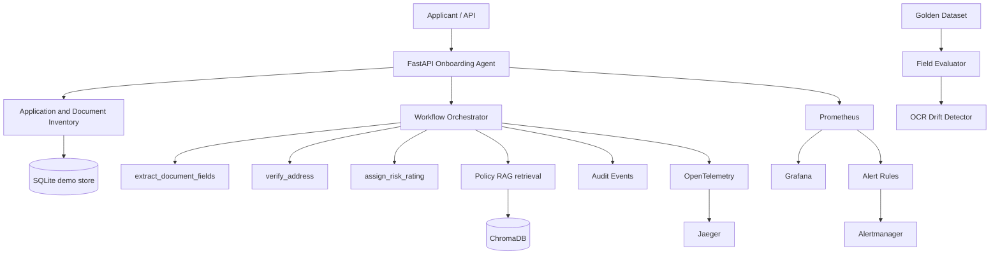
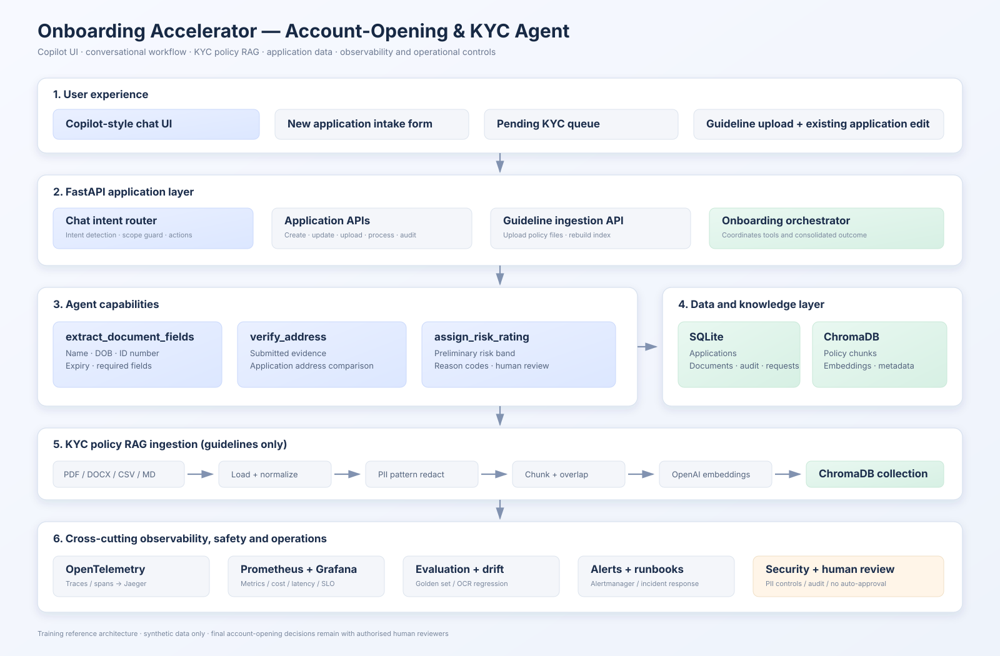

# Onboarding Accelerator — Account-Opening & KYC Agent

Runnable training capstone reference implementation. It consolidates the applicant journey, maintains a document inventory, runs the three required tools (`extract_document_fields`, `verify_address`, `assign_risk_rating`), retrieves policy guidance through RAG, records auditable events and exposes observability for the business SLO.

> **Synthetic training data only.** This is not a production bank onboarding, AML, identity-authenticity or account-approval system. Clean cases can complete the automated preliminary checks without routine human intervention; mismatches and incomplete evidence are routed for review. Final bank approval remains outside scope. Never use real customer KYC documents in this demo.

## Business capabilities

- One application record per `applicant_id`.
- Document intake and inventory with received/verified/needs-review state.
- Field extraction, required-field checks and expiry checks.
- Address comparison against the application address.
- Transparent preliminary risk triage.
- Policy retrieval using chunked documents and persistent ChromaDB.
- Duplicate document-request guard: block requests for a document already received or verified.
- Request history and chronological audit events.
- Field-level golden-dataset evaluation and simulated OCR vendor regression.
- OpenTelemetry, Jaeger, Prometheus, Grafana and Alertmanager.
- Business SLO: applications reaching a preliminary decision without a duplicate request for an already received/verified document.

## Architecture



**Keep the stores separate:** ChromaDB stores policy/reference chunks; SQLite stores applicant state, submitted-document inventory, requests and audit events; `data/ground_truth.json` is only the labelled evaluation set.

## API endpoints

Swagger: `http://localhost:8000/docs`

| Method | Endpoint | Purpose |
|---|---|---|
| GET | `/` | Copilot-style frontend |
| POST | `/chat` | Conversational intent routing and guideline scope guard |
| GET | `/applications` | List applications / pending queue data |
| GET | `/health` | Health check |
| POST | `/applications` | Create applicant application |
| GET | `/applications/{id}` | Application and latest assessment |
| PATCH | `/applications/{id}` | Update applicant name/address/DOB and automatically re-run checks when documents exist |
| POST | `/applications/{id}/documents` | Register submitted document text |
| POST | `/applications/{id}/documents/upload` | Upload text-readable PDF/DOCX/TXT/MD applicant document |
| GET | `/applications/{id}/documents` | List document inventory (without document text) |
| POST | `/applications/{id}/process` | Process all documents in inventory |
| POST | `/applications/{id}/document-requests` | Request missing/replacement document; duplicate guard applies |
| GET | `/applications/{id}/document-requests` | Request history |
| GET | `/applications/{id}/audit` | Audit events |
| GET | `/slo/summary` | Business SLO summary |
| POST | `/guidelines/upload` | Upload and re-index policy guidelines in ChromaDB |
| GET | `/guidelines` | List uploaded guideline sources |
| GET | `/knowledge/search` | Search policy chunks |
| POST | `/evaluation/run` | Field-level evaluation |
| POST | `/demo/ocr-degradation` | Simulate silent DOB extraction regression |
| GET | `/drift/status` | Drift state |
| GET | `/metrics` | Prometheus metrics |

## Docker quick start (recommended)

PowerShell:
```powershell
Copy-Item .env.example .env
```
Edit `.env` and set `OPENAI_API_KEY` to enable automatic policy embedding/indexing. `LLM_PROVIDER=mock` remains the default, so the KYC field extractor uses the deterministic labelled-text parser. Set `LLM_PROVIDER=openai` only if you also want model-based text extraction.

Start everything:
```powershell
docker compose up --build
```
Compose starts a one-shot `rag-ingest` service before the API. With an API key it loads, redacts, chunks, embeds and stores policy docs in the shared `chroma-data` volume. With no key it prints a skip message and the mock workflow still starts.

After adding/changing policy documents:
```powershell
docker compose run --rm rag-ingest
```

Service URLs: API/Swagger `:8000/docs`, Prometheus `:9090`, Grafana `:3000` (`admin` / `.env` password), Jaeger `:16686`, Alertmanager `:9093`.

## PowerShell demo walkthrough

### 1. Create application
```powershell
$body = @{ applicant_id="demo-001"; full_name="Asha Rao"; date_of_birth="1990-06-15"; email="asha@example.test"; application_address="12 Sample Road, Hyderabad, Telangana, 500001" } | ConvertTo-Json
Invoke-RestMethod -Uri "http://localhost:8000/applications" -Method Post -ContentType "application/json" -Body $body
```

### 2. Submit passport
```powershell
$body = @{ document_type="passport"; vendor_version="ocr-v1"; source_filename="synthetic-passport.txt"; document_text="Name: Asha Rao`nDate of Birth: 1990-06-15`nDocument Number: P1234567`nExpiry Date: 2030-06-15`nAddress: 12 Sample Road, Hyderabad, Telangana, 500001" } | ConvertTo-Json
Invoke-RestMethod -Uri "http://localhost:8000/applications/demo-001/documents" -Method Post -ContentType "application/json" -Body $body
```

### 3. Submit proof of address
```powershell
$body = @{ document_type="proof_of_address"; vendor_version="ocr-v1"; document_text="Name: Asha Rao`nAddress: 12 Sample Road, Hyderabad, Telangana, 500001`nStatement Date: 2026-10-01" } | ConvertTo-Json
Invoke-RestMethod -Uri "http://localhost:8000/applications/demo-001/documents" -Method Post -ContentType "application/json" -Body $body
```

### 4. Process all submitted documents
```powershell
Invoke-RestMethod -Uri "http://localhost:8000/applications/demo-001/process" -Method Post -ContentType "application/json" -Body "{}"
```

### 5. Inspect inventory and audit
```powershell
Invoke-RestMethod "http://localhost:8000/applications/demo-001/documents"
Invoke-RestMethod "http://localhost:8000/applications/demo-001/audit"
Invoke-RestMethod "http://localhost:8000/applications/demo-001"
```

### 6. Demonstrate duplicate-request prevention
```powershell
$body = @{ document_type="passport"; reason="Passport copy required" } | ConvertTo-Json
Invoke-RestMethod -Uri "http://localhost:8000/applications/demo-001/document-requests" -Method Post -ContentType "application/json" -Body $body
```
Expected: `sent_to_customer = false`, status `BLOCKED_DUPLICATE`. A replacement request can be sent if the earlier document is marked `NEEDS_REVIEW`.

### 7. Show the business SLO
```powershell
Invoke-RestMethod "http://localhost:8000/slo/summary"
```
The denominator is applications with a recorded preliminary decision. The numerator excludes decisions associated with an actual duplicate request sent for a document already received/verified. Blocked attempts are separately audited and do not count as customer re-requests. The 95% target is illustrative and must be agreed with the business.

### 8. Evaluation and OCR regression demo
```powershell
Invoke-RestMethod -Uri "http://localhost:8000/evaluation/run" -Method Post -ContentType "application/json" -Body "{}"
Invoke-RestMethod -Uri "http://localhost:8000/demo/ocr-degradation" -Method Post
Invoke-RestMethod "http://localhost:8000/drift/status"
```

## RAG pipeline

Place synthetic policy/reference files in `documents/` (`pdf`, `docx`, `html`, `csv`, `json`, `txt`, `md`). Pipeline: loaders → PII pattern redaction → logical text units → paragraph/sentence-aware overlap chunking → OpenAI embeddings → ChromaDB `kyc_policy_knowledge` → top-K retrieval.

Defaults: 1,000-character chunks and 150-character overlap. Set `RAG_SCOPE_DISTANCE_THRESHOLD` (default `0.75`) to tune the retrieval scope gate using labelled in-scope and out-of-scope test queries. Search at `/knowledge/search?q=passport%20requirements&top_k=4`. The Docker named volume `chroma-data` is mounted at `/app/chroma_store`; it is not a normal host folder.

## Automated KYC decision behaviour

For every active document, `extract_document_fields` extracts labelled fields and checks required fields/expiry. The workflow compares extracted identity name and DOB with the applicant record, checks the name on address evidence when available, calls `verify_address` using only an explicit proof-of-address document (an address printed on an identity document is not sufficient), then calls `assign_risk_rating`. The result includes `identity_verification`, `address_verification`, `verification_issues`, `tool_results`, `tools_executed` and an automated preliminary decision. Each tool completion/failure is recorded as an audit event.

- `PRELIMINARY_KYC_PASSED`: all configured pre-checks passed; no routine human intervention is needed for this synthetic demo.
- `NEEDS_MORE_INFORMATION`: evidence or required applicant data is missing/incomplete.
- `MANUAL_REVIEW`: identity/address mismatch or expired/invalid evidence needs exception handling.

Changing applicant details or adding/replacing a document invalidates the previous assessment. The API re-runs checks on applicant-detail updates; the UI re-runs checks after replacement uploads. The new-application form clears after successful submission and prevents repeated clicks while processing.

## Important boundaries / known limitations

- Applicant uploads support text-readable PDF, DOCX, TXT and Markdown. Scanned images and image-only PDFs require a separately approved OCR integration. The OpenAI adapter is text extraction, not OCR.
- No document authenticity, sanctions, PEP, fraud or official identity-database verification is implemented.
- Address comparison ignores case, whitespace and punctuation but otherwise uses normalized exact-string matching; it is not proof of identity or residency.
- Risk bands are transparent demo rules, not a validated bank risk model.
- The duplicate guard blocks requests when a same-type document is `RECEIVED` or `VERIFIED`; a replacement request can be made after `NEEDS_REVIEW`.
- SQLite, regex PII handling and audit storage are demo-only. Production needs encrypted managed storage, RBAC, immutable audit, retention controls, malware scanning, authentication, authorization, durable queues and an approved human-review process.
- `PRELIMINARY_KYC_PASSED` means the configured synthetic-data pre-checks passed without routine human intervention; it is not account approval. Production identity/authenticity checks and final bank approval remain separate.
- OCR drift simulation deliberately corrupts labelled DOB output; it is not a live vendor integration.

## Tests

```powershell
pip install -r requirements.txt
$env:PYTHONPATH="src"
pytest -q
```


## Architecture diagram



See [ARCHITECTURE.md](ARCHITECTURE.md) for the Mermaid source, runtime scenarios and trust boundaries.

## Copilot-style frontend and conversational scenarios

The web UI is served by the FastAPI application at **http://localhost:8000/**. The app supports text-based applicant document uploads and guideline uploads; the guideline source folder and ChromaDB index persist in Docker named volumes. It provides a chat-style interface, new-application form, pending-KYC queue, guideline upload/indexing page, and existing-application modification form.

### Scenario A — find applications pending KYC
Type in Copilot chat: `Show me application IDs pending for KYC verification`. The agent reads the SQLite application database and returns IDs with no completed assessment or a review/needs-information status. Select an application and ask `Verify KYC for application APP-...` to run the preliminary checks.

### Scenario B — modify an existing application
Examples: `Change name to Asha Rao for application APP-12345678` or `Update address to 12 Example Road for application APP-12345678`. Applicant detail changes automatically re-run the checks against active documents. For document changes, type `Replace passport document for application APP-12345678`; use the Modify Existing Application form to upload the replacement. Changes and uploads are recorded in the audit trail.

### Scenario C — start a fresh account application
Type: `I want to open a new account`. The Copilot opens the New Application form. Enter name, email and address, select an identity-document type and upload a text-readable synthetic identity document plus proof of address. Date of birth and declared residential address are captured for matching. The UI creates a unique application ID, registers the identity and address documents, and runs all three tools automatically. The result includes name/DOB/address matches, document expiry/completeness, risk band and reason codes. The form resets after successful processing. Applicant changes and document replacements invalidate the old result and trigger re-verification.

### Upload KYC guidelines
Open **KYC guidelines**, upload approved policy/reference documentation and select **Upload & index in ChromaDB**. The API stores the file in `documents/`, rebuilds the policy collection and reports the number of indexed chunks. Set `OPENAI_API_KEY` in `.env` for OpenAI embeddings. If re-indexing fails, the uploaded file remains on disk but the knowledge collection may need to be rebuilt after fixing the configuration.

### Out-of-scope behavior
The Copilot only answers policy questions when relevant passages can be retrieved from the indexed KYC guidelines (using a configurable similarity-distance gate). If no relevant passage is found, it responds that the question is outside the uploaded guideline scope or that the knowledge base is not indexed. It does not invent bank policy. The chat intent router is deterministic for this capstone; it is not a fully autonomous general-purpose LLM planner.

### Frontend/API security and implementation limits
- The frontend is a lightweight single-page web UI served by FastAPI; no separate Node build is required.
- Applicant uploads support text-based PDF, DOCX, TXT and Markdown extraction. Scanned images and image-only PDFs need a separately approved OCR integration.
- The UI/API is unauthenticated in this local training stack. Do not expose it publicly or use real customer data. Add SSO, RBAC, CSRF protections, encryption, malware scanning, retention controls and security review before any production use.
- Applicant document text is retained in the demo SQLite database so the mock extraction and audit flow can be demonstrated. Use synthetic documents only.
- The name/address updates are direct training mutations. A real bank workflow should apply maker-checker controls and verify changes against approved evidence.
- Policy scope threshold is a demonstration setting, not a legally validated classifier. Tune it against an approved in-scope/out-of-scope test set.
